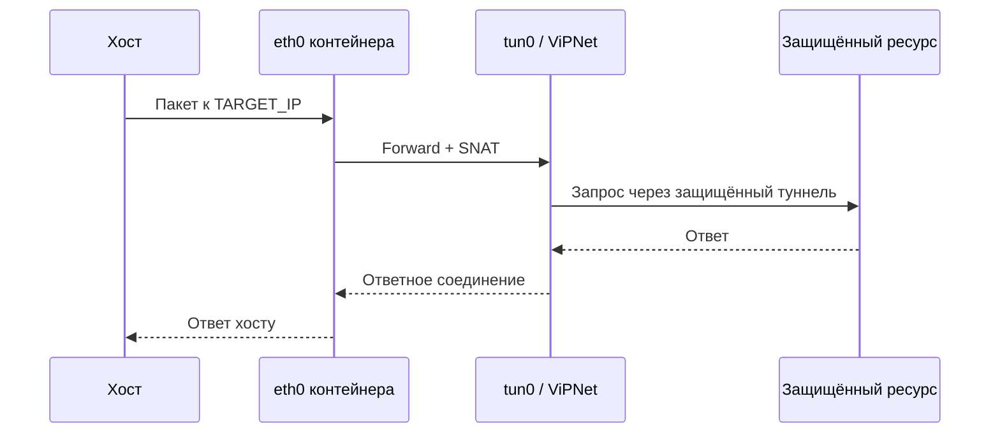

# Маршрутизация и связность

Хост и контейнер имеют отдельные сетевые пространства имён. Поэтому маршрут на хосте, маршрут внутри контейнера, forwarding и NAT нужно проверять отдельно.

## 1. Проверить клиент и интерфейсы

```bash
sudo docker exec ИМЯ_КОНТЕЙНЕРА vipnetclient info
sudo docker exec ИМЯ_КОНТЕЙНЕРА ip -br addr
sudo docker exec ИМЯ_КОНТЕЙНЕРА ip route
```

Перед настройкой маршрута подтвердите, что клиент действительно подключён и в контейнере существует `tun0`.

## 2. Проверить маршрут к целевому адресу

Выберите IPv4-адрес ресурса, который разрешено проверять:

```bash
ip route get TARGET_IP
sudo docker exec ИМЯ_КОНТЕЙНЕРА ip route get TARGET_IP
```

`TARGET_IP` — placeholder, замените его реальным адресом. Примеры `192.0.2.0/24` и `198.51.100.0/24` зарезервированы для документации и не являются реальными адресами защищённой сети.

Скрипт `scripts/route.sh` предполагает, что хост может маршрутизировать адрес `/32` через IPv4-адрес контейнера, а внутри контейнера существуют интерфейсы `eth0` и `tun0`. Он проверяет forwarding в контейнере, создаёт отдельные цепочки `iptables` для конкретного целевого IPv4-адреса и добавляет точечный маршрут на хосте. Скрипт не включает forwarding автоматически и не перезаписывает существующий маршрут к этому адресу.

```bash
sudo env TARGET_IP=АДРЕС ./scripts/route.sh check
sudo env TARGET_IP=АДРЕС ./scripts/route.sh apply
```

По умолчанию имя контейнера — `vipnet-diag`. Чтобы использовать другое имя, задайте `CONTAINER=...`.

## 3. Что должно происходить



Это логическая схема. Фактический путь и адреса зависят от конфигурации ViPNet и сети.

## 4. Если соединение не работает

Проверьте последовательно:

1. На хосте маршрут к `TARGET_IP` ведёт через IP нужного контейнера.
2. В контейнере маршрут к `TARGET_IP` использует ожидаемый интерфейс `tun0`.
3. IPv4 forwarding внутри контейнера включён (`1`).
4. Правила `FORWARD` и `SNAT` присутствуют и не перекрываются более ранними правилами firewall.
5. Запрос действительно уходит через туннель.
6. Ответ возвращается через ожидаемый путь.

Скрипт добавляет отдельные переходы к своим цепочкам в начало `FORWARD` и `POSTROUTING`, а сами правила ограничивает целевым адресом. Это уменьшает риск, что более раннее общее правило перекроет сценарий, но не гарантирует прохождение через другие цепочки, дополнительные правила, политики хоста или ограничения на стороне ViPNet.

Для TCP можно сравнить SYN и SYN-ACK на доступных интерфейсах с помощью `tcpdump`. Если SYN покидает хост, но SYN-ACK не возвращается, причина может быть в целевом узле, ACL, удалённой маршрутизации или обратном пути — это не является автоматическим доказательством блокировки со стороны СЗИ.

## 5. Удалить настройку

Пока контейнер запущен и интерфейс `tun0` доступен:

```bash
sudo env TARGET_IP=АДРЕС ./scripts/route.sh remove
```

Команда удаляет только переходы и выделенные цепочки проекта для выбранного адреса. Маршрут на хосте удаляется только если файл состояния `/run/vipnet-route-АДРЕС.state` подтверждает, что его добавил этот скрипт, и маршрут всё ещё ведёт через тот же IP контейнера. Если файл состояния потерян, скрипт намеренно оставляет маршрут и сообщает об этом. Старые правила, созданные предыдущей версией скрипта напрямую в `FORWARD`/`POSTROUTING`, автоматически не удаляются: проверьте их вручную перед миграцией. Не запускайте команды вслепую в чужом сетевом окружении.

## Трафик с других машин

Маршрутизация трафика, созданного на самом Docker-хосте, отличается от транзитного трафика других машин. Для последнего могут потребоваться отдельные маршруты, forwarding, правила host firewall и корректный обратный маршрут. Это не настраивается автоматически данным скриптом.
